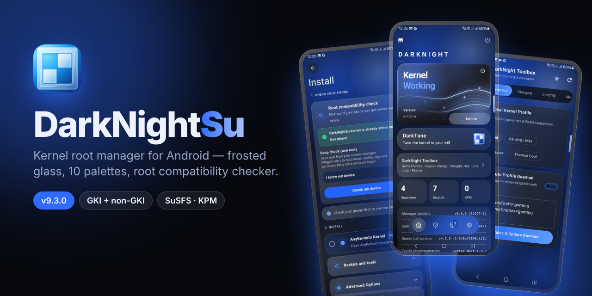
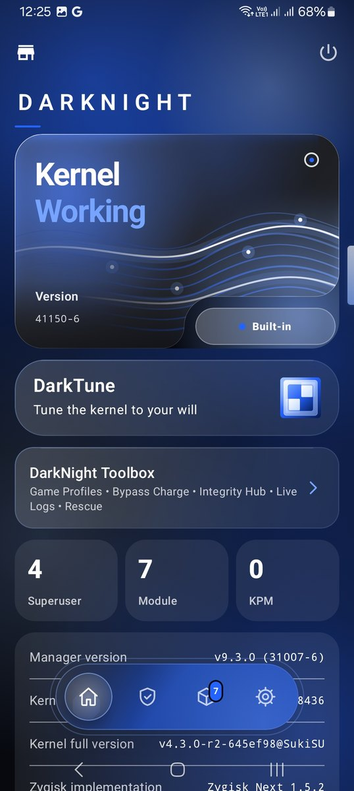
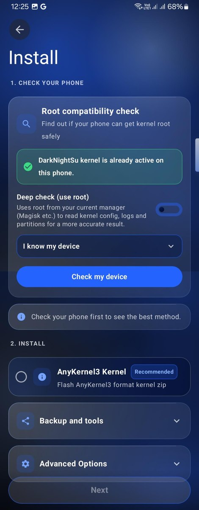
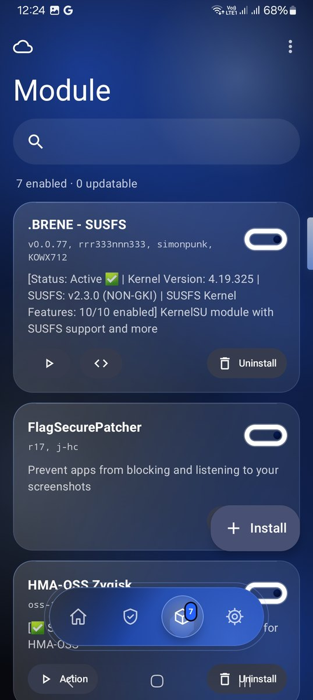
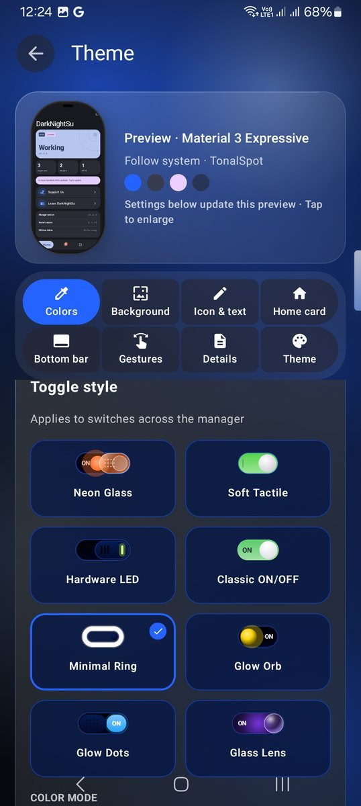
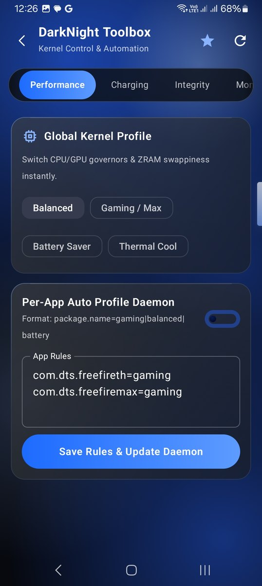
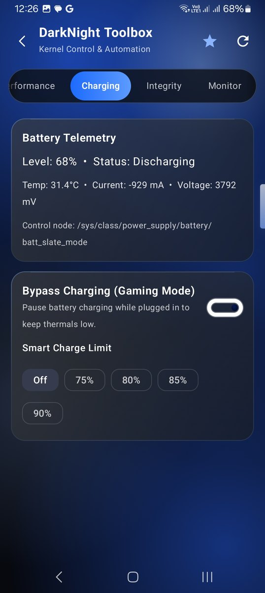
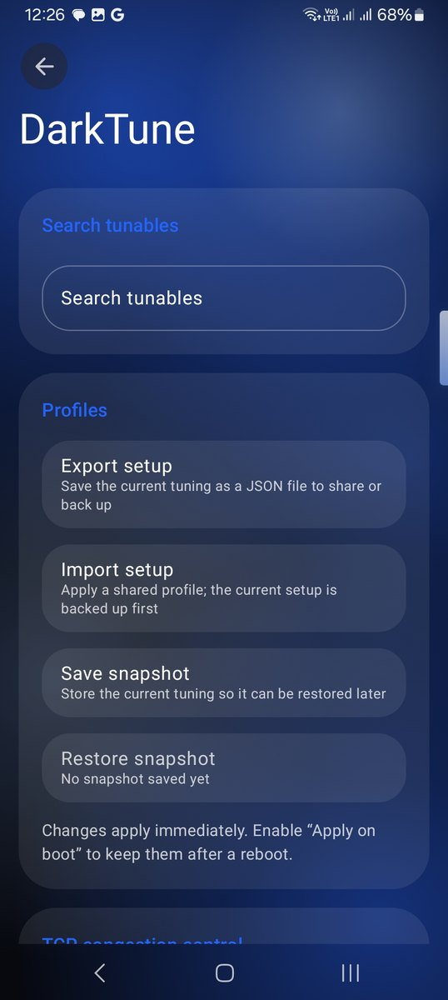
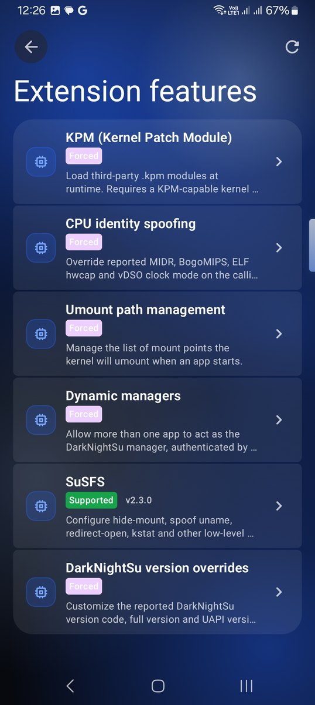

<div align="center">


# DarkNightSu

**Kernel root manager for Android — dressed in glass.**

Frosted-glass UI · 10 live palettes · DarkNight Toolbox · DarkTune · SuSFS · KPM · built-in root compatibility checker

[](https://github.com/max-araf/DarkNightSu/releases/latest)
[](https://github.com/max-araf/DarkNightSu/releases)
[](https://t.me/darknightsu)
[](https://max-araf.github.io/DarkNightSu/)
[](https://www.gnu.org/licenses/old-licenses/gpl-2.0.en.html)
[](/LICENSE)

[**⬇ Download**](https://github.com/max-araf/DarkNightSu/releases/latest) ·
[**🌐 Website**](https://max-araf.github.io/DarkNightSu/) ·
[**💬 Telegram group**](https://t.me/darknightsu) ·
[**🐞 Report a bug**](https://t.me/darknightsu/8) ·
[**👤 Developer**](https://t.me/Max_araf_2010)



</div>

---

DarkNightSu is a kernel-based root solution built on [KazeSU](https://github.com/KazeSU/KazeSU)
(→ SukiSU Nova → SukiSU-Ultra → KernelSU). The kernel does the work; the manager does everything
around it — with a frosted-glass interface you can recolour, a kernel toolbox, and a checker that
tells you **before you flash** whether your phone is a good fit.

> [!IMPORTANT]
> Install only the official manager APK from [Releases](https://github.com/max-araf/DarkNightSu/releases) —
> the file whose name ends in `-release.apk`. Debug, PR and CI builds use a different certificate and
> the kernel rejects them as unofficial.

> [!WARNING]
> If your phone's kernel does not support kernel root, **do not use this**. The manager cannot force
> root onto an unsupported kernel, and flashing a wrong image can brick your phone.
> **Always back up your original boot image first** (Install → Backup and tools → Extract).

## Screenshots

<table>
  <tr>
    <td align="center"><br><sub><b>Home</b></sub></td>
    <td align="center"><br><sub><b>Root compatibility checker</b></sub></td>
    <td align="center"><br><sub><b>Modules</b></sub></td>
    <td align="center"><br><sub><b>Theme studio</b></sub></td>
  </tr>
  <tr>
    <td align="center"><br><sub><b>Toolbox · Performance</b></sub></td>
    <td align="center"><br><sub><b>Toolbox · Charging</b></sub></td>
    <td align="center"><br><sub><b>DarkTune</b></sub></td>
    <td align="center"><br><sub><b>Extension features</b></sub></td>
  </tr>
</table>

> Swipe through them in colour on the **[website](https://max-araf.github.io/DarkNightSu/)** — pick any of the 10 palettes and the screenshots re-theme live.

## Highlights

| | |
|---|---|
| 🎨 **10 live palettes** | DarkNight Aura, Royal Violet, Crimson Noir, Forest Noir, Golden Bronze, Cyber Ocean, Amber Glow, Royal Ember, Mint Aurora, Royal Charcoal. Logo, splash, glass and toggles follow your pick. |
| 🧊 **Frosted-glass UI** | Material 3 and Miuix styles, floating pill dock or sidebar. **Theme Studio**: colours, background, icon & text, home card, bottom bar, gestures and 8 toggle styles. |
| 🔍 **Root compatibility checker** | Reads Android/SDK, ABI, kernel, boot-image header, partitions (boot / init_boot / recovery, with sizes), bootloader state and vendor protection, then recommends one method. Optional **Deep check** with root and an **I know my device** override. |
| 🛠️ **DarkNight Toolbox** | Global kernel profiles, per-app auto-profile daemon, bypass charging, smart charge limit, Integrity Hub, live logs, rescue. |
| 🎛️ **DarkTune** | Search kernel tunables, TCP congestion control, export / import setups, snapshots. |
| 🛡️ **SuSFS · KPM** | SuSFS hide-mount, uname spoofing, redirect-open (needs a SuSFS kernel); KPM, CPU identity spoofing, umount paths, dynamic managers, version overrides. |
| 📦 **Flash · patch · extract** | Patch a boot image, flash AnyKernel3 zips, use a local LKM, extract boot / init_boot / recovery to *Download/DarkNightSu*. Guided **Quick start**. |
| 🏪 **Theme store** | Browse, submit and apply online themes; live side info bar for CPU, battery and temperature. |
| 🧩 **Modules & App Profile** | Module list with Action and WebUI, per-app root profiles and templates. |

## Root compatibility checker

Open **Install → Check my device**. The checker is a *heuristic*: properties and `uname` can be spoofed,
so it cross-checks several signals and shows uncertain things as **RISK** instead of wrongly blocking you.

| Severity | Meaning |
|---|---|
| **OK / INFO** | Looks fine / good to know |
| **WARN** | Worth a look before continuing |
| **RISK** | Might not work or could be dangerous — you decide |
| **BLOCK** | Truly unsupported (e.g. SDK below 26, 32-bit ARM kernel) |

What it recommends:

| Your phone | Recommended method | Notes |
|---|---|---|
| **GKI** — kernel 5.10+, boot header v3 / v4 | *Select a file and patch* (LKM) | Patch `init_boot.img` if the phone launched with Android 13+, otherwise `boot.img` |
| **Non-GKI** — older kernels, boot header v0–v2 | *AnyKernel3 kernel zip* | The kernel needs DarkNightSu built in; boot-image patching is not possible |
| KPM | `CONFIG_KPM=y` | Needs a KPM-capable kernel; non-GKI also needs `CONFIG_KALLSYMS=y` and `CONFIG_KALLSYMS_ALL=y` |
| SuSFS | SuSFS kernel | Needs a kernel built with SuSFS |

Manager APKs: **arm64-v8a**, **armeabi-v7a** and **universal**.

## Install

1. Download the official `-release.apk` for your phone from [Releases](https://github.com/max-araf/DarkNightSu/releases/latest).
2. Open **Install → Check my device**, read the verdict and the recommended method.
3. Back up your boot image, tap **Quick start**, then **Next**.
4. Reboot, open the manager and make it yours (Settings → Theme).

## Kernel integration

Run this in the **root of your kernel source**:

```bash
curl -LSs "https://raw.githubusercontent.com/max-araf/DarkNightSu/main/kernel/setup.sh" | bash -s main
```

`setup.sh` also accepts `--cleanup`, `--submodule` or a specific commit / tag instead of `main`.
Then enable `CONFIG_KSU`, and `CONFIG_KPM` on 64-bit kernels for KPM. Full guide: [DARKNIGHT_SETUP.md](DARKNIGHT_SETUP.md).

## Build

```bash
just bm   # cross-build ksud (aarch64) + bundled debug manager APK
just bk   # ksud only
```

`ksud` is built with [`cross`](https://github.com/cross-rs/cross); the manager is a Gradle/Kotlin project under `manager/`.

## FAQ

<details><summary><b>The checker says my bootloader is locked, but I unlocked it.</b></summary>

Spoofing modules (integrity, uname) change what apps can read. The checker shows a **RISK** instead of
blocking you, and **I know my device** lets you tell it the truth.
</details>

<details><summary><b>Do I patch boot.img on a non-GKI phone?</b></summary>

No. Boot-image patching (LKM) needs a GKI kernel. On non-GKI phones flash an AnyKernel3 zip with
DarkNightSu built into the kernel, or build your own kernel with `kernel/setup.sh`.
</details>

<details><summary><b>init_boot or boot?</b></summary>

It follows how the phone launched. Phones that launched with Android 13+ usually have `init_boot`;
older ones use `boot`. The checker reads the real partition list.
</details>

<details><summary><b>Where do I report bugs?</b></summary>

In the **[Issues topic](https://t.me/darknightsu/8)** of the Telegram group, or as a
[GitHub issue](https://github.com/max-araf/DarkNightSu/issues). In the app, *Send logs* shares the report and points you to the topic.
</details>

## Repository layout

| Path | Contents |
|---|---|
| `kernel/` | Kernel module: hooks, policy, SuSFS, KPM, security, `setup.sh` |
| `userspace/` | `ksud` (Rust daemon), `ksuinit`, module tooling |
| `manager/` | Android manager app (Compose, Material 3 + Miuix) |
| `uapi/` | Shared kernel/userspace headers |
| `docs/` | Guides and logo assets |
| `site/` | Website source (GitHub Pages) |
| `.github/` | CI workflows, release assembly, Pages deploy |

## Community

[Telegram group](https://t.me/darknightsu) · [Issues topic](https://t.me/darknightsu/8) ·
[Developer on Telegram](https://t.me/Max_araf_2010) · [max-araf on GitHub](https://github.com/max-araf)

## License

- `kernel/` is [GPL-2.0-only](https://www.gnu.org/licenses/old-licenses/gpl-2.0.en.html).
- The anime `ic_launcher*` icon files from KazeSU are covered by `LICENSE_icon_English` / `LICENSE_icon_SC` — **do not reuse them**; DarkNightSu ships its own logo.
- Everything else is [GPL-3.0-or-later](LICENSE).

## Acknowledgements

[KazeSU](https://github.com/KazeSU/KazeSU), [SukiSU Nova](https://github.com/SukiSU-Nova/SukiSU-Nova),
[SukiSU-Ultra](https://github.com/SukiSU-Ultra/SukiSU-Ultra), [KernelSU](https://github.com/tiann/KernelSU),
[KernelPatch](https://github.com/bmax121/KernelPatch), [susfs](https://gitlab.com/simonpunk/susfs4ksu),
and Kagami (Rouyashiki/YukiSU) for the magic-mount backend.

<div align="center"><sub>Made by <a href="https://github.com/max-araf">max-araf</a></sub></div>
